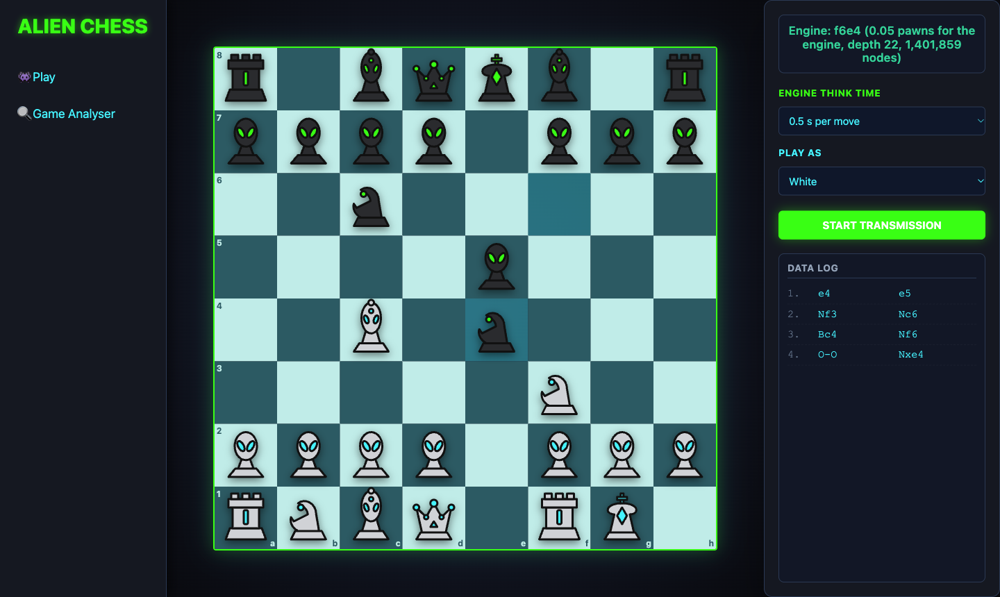
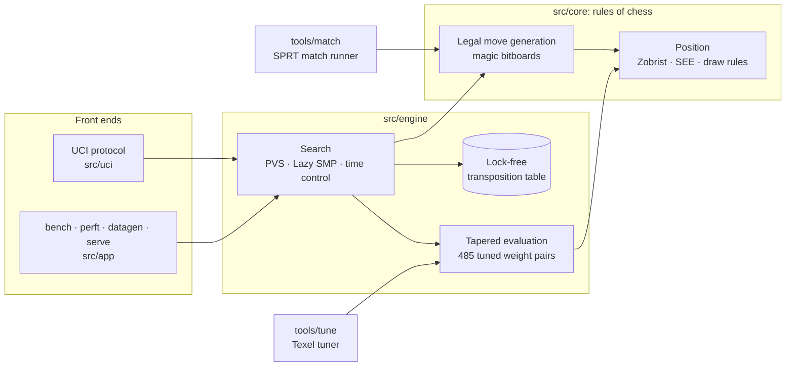
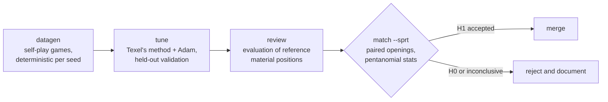

<div align="center">

# Chess Engine

**A multi-threaded UCI chess engine in modern C++, with the tooling to prove how well it plays.**

[](https://github.com/varad-oss/chess-engine/actions/workflows/ci.yml)


[Results](#results) · [Quick start](#quick-start) · [Architecture](#architecture) · [Design notes](docs/DESIGN.md) · [Full measurements](docs/RESULTS.md)



</div>

---

Most hobby engines state a rating. This one shows its work. The move
generator is checked against published perft counts down to 640 million leaf
nodes. The evaluation weights are fitted to self-play data by an in-repo
Texel tuner. Strength changes go in only after passing a statistical test
(SPRT) run by an in-repo match runner, and changes that failed are documented
as well.

## Highlights

- **Correctness first.** Strictly legal move generation (pin and check
  masks, no make/unmake filtering) with magic bitboards whose multipliers are
  re-verified at every startup. Exact on 21 reference positions, including
  the en-passant pin and castling-through-check edge cases.
- **Modern search.** Principal variation search with aspiration windows,
  null-move pruning (guarded against zugzwang), late-move reductions with
  verified re-searches, SEE-based pruning, and quiescence search that resolves
  checks.
- **Concurrency done properly.** Lazy SMP over a lock-free transposition
  table. Entries use relaxed atomics with XOR key validation (Hyatt & Mann),
  so concurrent access is well-defined C++, not a tolerated data race.
  ThreadSanitizer reports nothing on a 4-thread search.
- **Data-driven evaluation.** A tapered evaluation with 485 (middlegame,
  endgame) weight pairs fitted by logistic regression on 3.6M self-play
  positions: **+118 ± 41 Elo** over the hand-set weights.
- **Measured, not claimed.** A process-level match runner with
  colour-reversed game pairs, pentanomial statistics and SPRT referees any
  two UCI engines.
- **Engineered like production code.** A warning-free build (`-Wall -Wextra
  -Wpedantic -Wshadow …`) on GCC and Clang; CI on Linux and macOS; ASan,
  UBSan and TSan jobs; and a deterministic search fingerprint
  ([bench](#benchmark-signature)) that matches across compilers and
  operating systems.

## Results

All measurements were taken on an Apple M5 laptop. Every command is listed in
[docs/RESULTS.md](docs/RESULTS.md).

| area | result |
| :-- | :-- |
| **Strength vs. version 1** | **+200 −0 =0** at equal time · **+193 −1 =6** with version 1 given **10x the thinking time** |
| **Evaluation tuning** | **+117.9 ± 41.0 Elo** over the hand-set weights (SPRT [0, 10] accepted, 209 games) |
| **Move generation** | 21 positions, 51 depths, 640,240,179 leaf nodes: all exact · 520+ M leaf nodes/s |
| **Perft speed vs. version 1** | **3.0x** like-for-like · **17.5x** with bulk counting (start position, depth 6) |
| **Parallel search** | 4 threads reach depth 18 **1.7x** faster; node throughput scales **3.2x** |
| **Protocol conformance** | 9/9 UCI integration tests, run against the real binary (version 1: 2/9) |
| **Test suite** | 30 unit-test groups (~400k assertions) + 17 integration tests, all passing; unit, protocol and perft suites run in CI on GCC and Clang |
| **Memory and thread safety** | clean under AddressSanitizer, UndefinedBehaviorSanitizer and ThreadSanitizer |

**Changes that were tested and rejected**, because a result only counts if it
could have gone the other way:

| change | outcome |
| :-- | :-- |
| Continuation history (move ordering) | +7.5 ± 10.5 Elo after 2,000 games; SPRT inconclusive, so **not merged** |
| Second tuning round on 7.2M positions | better validation loss, but a queen up was valued at +2317 cp in the middlegame and +277 in the endgame, so **rejected** ([analysis](docs/RESULTS.md#8-a-rejected-tuning-round)) |

## Quick start

Requires a C++20 compiler (GCC 11+ or Clang 14+) and `make`. No other dependencies.

```bash
git clone https://github.com/varad-oss/chess-engine.git && cd chess-engine
make -j                    # → build/release/chess-engine
make test                  # unit tests + UCI and HTTP integration tests (python3)
make perft                 # full perft suite, ~1 s
```

### Play it

The engine speaks [UCI](https://www.chessprogramming.org/UCI), so it plugs
into any chess GUI (Cute Chess, Arena, BanksiaGUI, En Croissant). Point the
GUI at `build/release/chess-engine`, or talk to it directly:

```text
$ build/release/chess-engine
position startpos moves e2e4
go depth 10
info depth 1 seldepth 3 multipv 1 score cp -10 nodes 28 nps 28000 hashfull 0 time 0 pv d7d5
...
info depth 10 seldepth 19 multipv 1 score cp -28 nodes 16050 nps 1337500 hashfull 11 time 12 pv d7d5 e4d5 g8f6 ...
bestmove d7d5 ponder e4d5
```

UCI options: `Hash`, `Threads`, `Move Overhead`, `Clear Hash`. Debug
commands: `d` (show the board), `eval` (static evaluation), `perft <depth>`
(divided perft).

### Browser demo

```bash
build/release/chess-engine serve           # engine API on 127.0.0.1:8765
python3 -m http.server -d frontend 8000    # then open http://localhost:8000
```

The page sends the whole game to the engine, so the engine sees
repetitions. The API listens on localhost only, re-validates every move,
caps think time and request size, and returns CORS headers only to local
origins.

## Architecture



Dependencies only point downward. The rules core knows nothing about search.
The match runner links only the rules core, so it can referee games between
*any* two UCI engines, including version 1, which shares no code with this
one. Each design decision and its alternatives are explained in
[docs/DESIGN.md](docs/DESIGN.md).

### How a change gets in



Search changes skip the first three steps and go straight to the SPRT gate.

## Verification

| layer | how it is checked |
| :-- | :-- |
| Move generation | perft against published counts for 21 positions at full depth; the browser's JavaScript generator is checked against the same file |
| Attack tables | magic lookups cross-checked against ray walking on 128k random occupancies; embedded multipliers verified at startup |
| Make/unmake | random walks assert that the incremental hash equals a from-scratch hash, the mailbox matches the bitboards, and unmake restores the exact FEN |
| `gives_check` | property test against make-then-test on every legal move of 400 positions |
| Evaluation | colour symmetry (a position and its mirror score the same); the tuner's linear model reproduces the engine's evaluation exactly |
| Search | mate-in-N and mated-in-N scores, stalemate, forced moves, node-limit exactness, determinism, `searchmoves` |
| Protocol and API | Python tests drive the real binary over pipes and HTTP: `stop`/`isready` mid-search, time limits, malformed input, oversized requests, CORS |
| Statistics | Elo and log-likelihood-ratio formulas unit-tested against hand calculations |
| Memory and races | the test suite and benchmarks under ASan + UBSan and TSan |

### Benchmark signature

```bash
build/release/chess-engine bench      # 30 positions, depth 13, 1 thread
```

The bench searches **1,707,612 nodes**, identically with GCC on Linux and
Clang on macOS. Any change to that number means the search behaves
differently, so refactors are checked against it. The number held across a
node-counter optimisation, the revert of a rejected feature, and a canonical
rewrite of the evaluation weights.

## Measuring strength

```bash
make tools
build/release/match \
  --engine1 build/release/chess-engine --name1 new \
  --engine2 path/to/baseline           --name2 base \
  --tc 8+0.08 --concurrency 8 --openings tools/match/openings.epd \
  --sprt 0 10 --games 4000
```

```text
Games 209: +121 -52 =36  Elo 117.9 +/- 41.0 (95%)  Penta [6 3 41 25 29]
SPRT: LLR 3.15 -> H1 accepted
```

Each opening (from 1,000 balanced 8-ply positions) is played twice with
colours reversed. The statistics treat each game pair as one observation
(pentanomial model), which accounts for the correlation inside a pair.
Per-engine clocks (`--tc1`/`--tc2`) allow time-odds matches.

## Tuning the evaluation

```bash
build/release/chess-engine datagen --games 40000 --nodes 5000 --threads 10 --out data/games.txt
build/release/tune --data data/games.txt --out src/engine/eval_params.cpp
make && build/release/match ... --sprt 0 10
```

The tuner fits Texel's logistic model using the engine's own feature
extraction and exact analytic gradients. It keeps the weights from the best
epoch on a held-out split, and leaves weights with too little phase-weighted
data at their prior value instead of fitting them to noise. It writes the
weights in a canonical form (each table's mean folded into the material value
by integer shifts), so the numbers are readable and the evaluation is
bit-for-bit unchanged.

## Repository layout

```
src/core/      rules: types, bitboards, position, legal move generation
src/engine/    evaluation (+ generated weights), transposition table, search
src/uci/       UCI protocol front end
src/app/       bench · perft · datagen · openings · serve
tools/match/   match runner with SPRT, opening suite
tools/tune/    Texel tuner
tests/         unit tests, perft data, UCI / HTTP / frontend integration tests
frontend/      single-page browser demo
docs/          design notes, audit of version 1, measured results
```

## Limitations and roadmap

- **No absolute rating yet.** Every Elo figure above is relative: between
  versions of this engine, or against version 1. A calibration run against
  Stockfish's `UCI_Elo` limiter is one command once Stockfish is installed
  ([docs/RESULTS.md](docs/RESULTS.md#not-measured-absolute-rating)).
- **Evaluation data.** Training games are fast self-play with early
  adjudication, so material advantages are valued higher in the middlegame
  than in the endgame (a queen: +1303 vs. +848 cp). Next step: regenerate the
  data without adjudication and add regularisation. Beyond that, an NNUE
  network.
- **Scope.** Standard chess only: no Chess960, pondering, MultiPV or
  tablebases. The match runner and HTTP server use POSIX APIs (Linux and
  macOS); the engine itself is portable C++20.

## Acknowledgements

The techniques here are documented on the [Chess Programming Wiki](https://www.chessprogramming.org).
In particular: magic bitboards (Pradyumna Kannan), lockless transposition
tables (Robert Hyatt and Timothy Mann), Texel's tuning method (Peter
Österlund), and the SPRT methodology used by [Fishtest](https://tests.stockfishchess.org)
(Michel Van den Bergh). The perft edge-case positions are Peter Ellis
Jones's. The implementation, tooling and all measurements are original to
this repository.

<sub>Version 2 is a ground-up rewrite. What was wrong with version 1, and how
each problem was confirmed, is recorded in [docs/AUDIT.md](docs/AUDIT.md).</sub>
